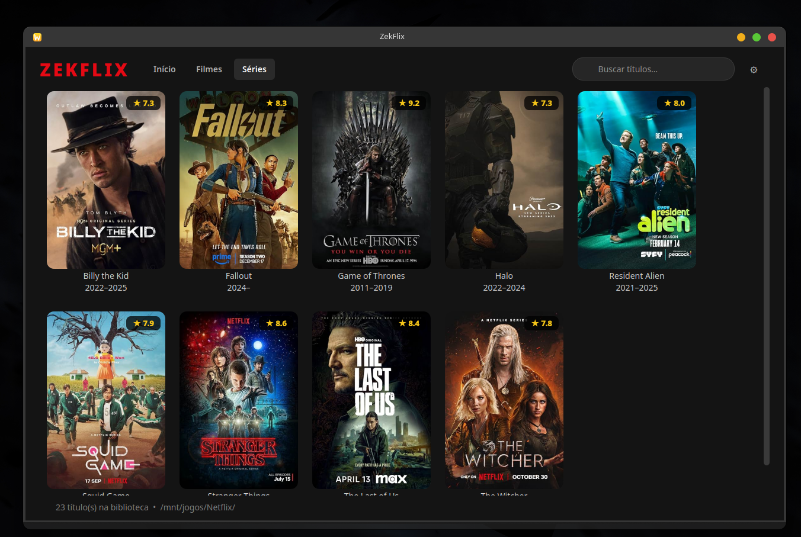

# 🎬 ZekFlix

Seus filmes e séries locais em uma interface **estilo Netflix** para Linux.

O ZekFlix lê a sua pasta de vídeos, busca capa, nota e descrição (em português) e mostra tudo em uma grade bonita e escura. Basta clicar e assistir.



## ✨ Funcionalidades

- Interface moderna e escura, com capas arredondadas e nota ★ do IMDb
- Capa, título, ano, gênero, elenco, nota e descrição **traduzida para português**
- Filmes e séries organizados automaticamente pelas pastas
- Episódios em ordem natural (ep2 antes do ep10); ao terminar um, toca o próximo
- Lembra onde você parou em cada vídeo
- **Cache local:** consulta o OMDb só para títulos novos, então abre rápido
- Busca por título
- Toca quase qualquer formato (mp4, mkv, avi, mov, webm, ts...) usando o **mpv**

## 📥 Instalação no Linux (AppImage)

1. Baixe o AppImage em **[Releases](../../releases/latest)**
2. Dê permissão de execução: botão direito → Propriedades → *Executar como programa*
   (ou `chmod +x ZekFlix-x86_64.AppImage`)
3. Instale o player **mpv**:
   - Fedora: `sudo dnf install mpv` (ative o [RPM Fusion](https://rpmfusion.org/Configuration) antes)
   - Ubuntu / Linux Mint: `sudo apt install mpv`
4. Abra o `ZekFlix-x86_64.AppImage`

> No Linux Mint / Ubuntu, se o AppImage não abrir: `sudo apt install libfuse2`

## 🪟 Instalação no Windows

Baixe em **[Releases](../../releases/latest)**:

| Arquivo | Para quem |
|---|---|
| `ZekFlix-Setup-x.y.z.exe` | **Instalador**: cria atalho no menu Iniciar (e na área de trabalho, se quiser) e desinstala pelo Painel de Controle |
| `ZekFlix-Portatil-x.y.z.zip` | **Portátil**: extraia em qualquer pasta ou pendrive e abra `ZekFlix.exe`. Configurações e cache ficam na pasta `data`, ao lado do programa |

O player **mpv já vem incluído**, não precisa instalar nada. Se o vídeo não abrir e aparecer um erro citando `vulkan-1.dll`, atualize o driver de vídeo (ou instale o [Vulkan Runtime](https://vulkan.lunarg.com/sdk/home#windows)).

> Como o programa não tem assinatura digital, o Windows pode mostrar o aviso "O Windows protegeu seu computador". Clique em **Mais informações → Executar assim mesmo**.

## 🔑 Chave do OMDb (gratuita)

Na primeira abertura o ZekFlix pede uma chave do OMDb, usada para baixar capas e descrições:

1. Acesse https://www.omdbapi.com/apikey.aspx
2. Escolha **FREE**, informe seu e-mail e **confirme o e-mail** que eles enviam
3. Cole a chave no ZekFlix

A chave fica salva só no seu computador (`~/.config/zekflix/config.json`). Para trocar depois: ⚙ → *Configurar chave do OMDb*.
O plano gratuito permite 1.000 consultas por dia.

## 📁 Como organizar suas pastas

Escolha uma pasta principal; dentro dela, **cada título tem a sua subpasta**:

```
Minha Biblioteca/
├── Matrix (1999)/            ← 1 vídeo = filme
│   └── matrix.mkv
├── Breaking Bad/             ← vários vídeos = série
│   ├── S01E01.mkv
│   ├── S01E02.mkv
│   └── ...
└── Interestelar 2014/
    └── filme.mp4
```

Colocar o **ano** no nome da pasta ajuda a encontrar o título certo.

## 🧰 Rodando pelo código-fonte

```bash
# Fedora
sudo dnf install python3-pyqt6 mpv
python3 zekflix.py
```

## 🛠️ Gerando o AppImage

```bash
bash build_appimage.sh
```

Ou crie uma tag (`git tag v1.0.1 && git push origin v1.0.1`) e o GitHub compila e publica em Releases automaticamente.

## 🗑️ Dados do programa

- Linux: configurações em `~/.config/zekflix/` e cache/capas em `~/.cache/zekflix/`
- Windows (instalado): `%APPDATA%\ZekFlix` e `%LOCALAPPDATA%\ZekFlix`
- Windows (portátil): pasta `data` ao lado do `ZekFlix.exe`

## 📄 Licença

MIT. Veja o arquivo [LICENSE](LICENSE).

Este produto usa a API do OMDb mas não é endossado nem certificado por ela.
